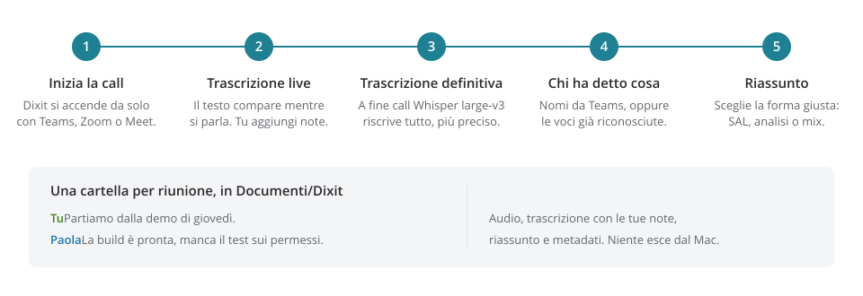
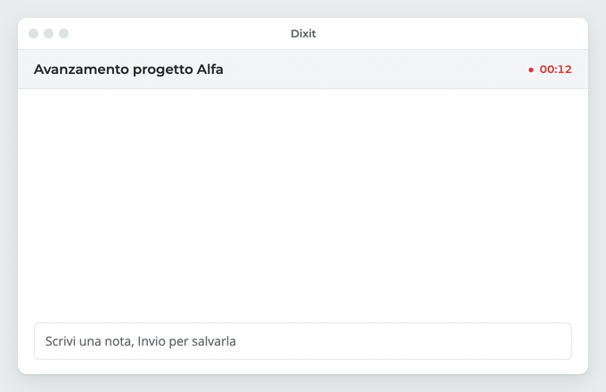
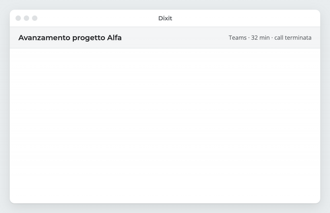
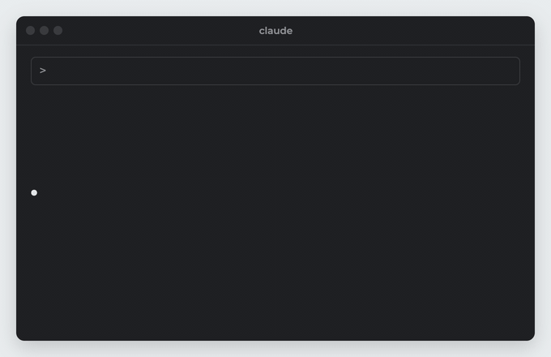
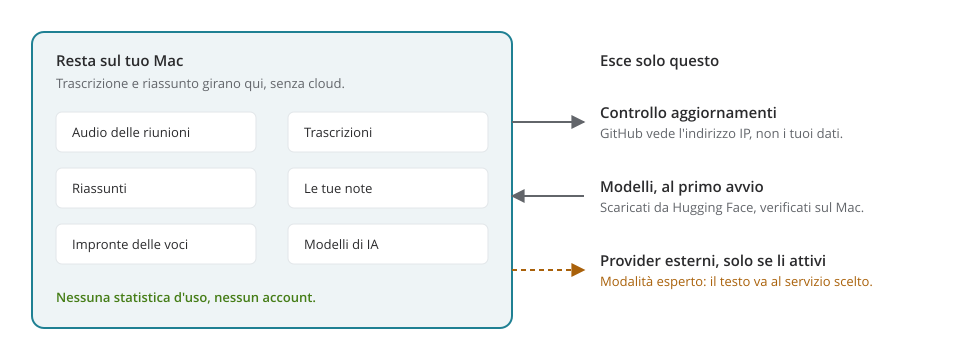

<div align="center">
  
  <h1>Dixit</h1>
  <p><b>Registra, trascrive e riassume le tue riunioni. Tutto sul tuo Mac.</b></p>
</div>

Dixit si accende da solo quando inizia una call su Teams, Zoom o Meet, trascrive sul Mac, riconosce chi parla e a fine call scrive il riassunto adatto al tipo di riunione. Nessun dato esce dal computer: i modelli girano sul Mac e non serve Ollama né un servizio cloud.

**Sito:** [cannoloops.github.io/dixit](https://cannoloops.github.io/dixit/) · **Download:** [ultima versione](https://github.com/cannoloops/dixit/releases/latest)

<p align="center"></p>

## Cosa fa

<p align="center"></p>
<p align="center"></p>

- **Avvio e stop automatici:** registra quando inizia una call e si ferma quando finisce. Puoi anche avviare a mano.
- **Trascrizione in due tempi:** testo live mentre si parla (Parakeet) e trascrizione definitiva, più precisa, a fine call (Whisper large-v3).
- **Chi ha detto cosa:** nelle call Teams usa i nomi reali; altrimenti riconosce le voci e le distingue.
- **Note durante la call:** scrivi una nota e premi Invio, e resta agganciata all'istante esatto. Le note compaiono dentro la trascrizione e aiutano il riassunto.
- **Riassunto per tipo di call:** Dixit riconosce da solo il tipo di riunione e sceglie la forma:
  - **SAL:** minuta con l'avanzamento lavori (fatto, in corso, bloccato), decisioni, azioni con chi e quando, rischi.
  - **Analisi:** documento strutturato con contesto, temi, requisiti emersi, decisioni e domande aperte.
  - **Mix:** la minuta SAL più una sezione di analisi.

  Il tipo si può cambiare a mano, e il riassunto si rigenera.
- **Una cartella per riunione** in `~/Documents/Dixit/`: audio, trascrizione in Markdown con le tue note, riassunto e metadati.
- **Per gli agenti:** un server MCP locale espone trascrizioni, riassunti e note ad agenti esterni (Claude Code, Claude Desktop), con ricerca per parola e per significato. Utile per esempio per alimentare una wiki.
- **Italiano e inglese.**

## Installazione

Serve un Mac con Apple Silicon (M1 o successivo), macOS 14.4 o superiore, circa 10 GB liberi e almeno 16 GB di RAM.

1. Scarica il `.dmg` dall'[ultima versione](https://github.com/cannoloops/dixit/releases/latest), aprilo e trascina **Dixit** in **Applicazioni**.
2. L'app non è notarizzata da Apple, quindi la prima volta macOS la blocca con l'avviso *«Apple non è in grado di verificare…»* (sul `.dmg`, sull'app o su entrambi). Da macOS 15 «tasto destro › Apri» non basta più:
   - nell'avviso premi **Fine**, non «Sposta nel Cestino»;
   - apri **Impostazioni di Sistema › Privacy e sicurezza**, scorri fino a **Sicurezza** e premi **Apri comunque**;
   - riapri il file e nel nuovo avviso premi di nuovo **Apri comunque**.

   In alternativa, dal Terminale:

   ```bash
   xattr -dr com.apple.quarantine /Applications/Dixit.app
   ```
3. Al primo avvio Dixit scarica i modelli (circa 9 GB, da Hugging Face, con verifica dell'integrità; se si interrompe riparte da dove era arrivato). Poi chiede tre permessi di macOS:
   - **Microfono:** per la tua voce;
   - **Registrazione schermo e audio di sistema:** per l'audio degli altri partecipanti;
   - **Accessibilità:** per leggere i nomi dei partecipanti da Teams.

Gli aggiornamenti arrivano da soli; riunioni, impostazioni e modelli restano.

La [guida di utilizzo](docs/GUIDA.md) spiega installazione, registrazione, note e riassunti passo per passo.

## Modelli

I modelli si scaricano al primo avvio e vanno bene così per quasi tutti. Solo chi sa cosa sta facendo li cambia, da **Impostazioni › Avanzate › Modalità esperto**.

| Uso | Modello |
|---|---|
| Trascrizione live | Parakeet TDT 0.6B v3 |
| Trascrizione definitiva | Whisper large-v3 |
| Riconoscimento dei parlanti | wespeaker ResNet34 |
| Riassunto | Gemma 4 E4B |
| Ricerca per significato | EmbeddingGemma 300M |

Sui Mac con molta RAM (32 GB o più), in modalità esperto si può scaricare **Gemma 4 26B-A4B**, che fa riassunti migliori. Il confronto è in [docs/confronto-modelli-riassunto.md](docs/confronto-modelli-riassunto.md).

## Usare Dixit con un agente (MCP)

Con l'opzione MCP attiva, Dixit espone un server locale su `http://127.0.0.1:7337/mcp`, raggiungibile solo dal tuo Mac e in sola lettura. Per collegarlo a Claude Code:

```bash
claude mcp add --transport http dixit http://127.0.0.1:7337/mcp
```

<p align="center"></p>

| Tool | A cosa serve |
|---|---|
| `live_transcript` | La trascrizione della call in corso |
| `list_meetings` | L'elenco delle riunioni, filtrabile per data o per ultime modifiche |
| `get_meeting` | Una riunione completa: riassunto, tipo di call, partecipanti, note e trascrizione, in JSON o Markdown |
| `search_transcripts` | Ricerca nelle trascrizioni, nelle note e nei riassunti: per parola esatta, per significato o mista |

## Privacy

<p align="center"></p>

- Audio, trascrizioni, riassunti e note restano sul Mac: dati dell'app in `~/Library/Application Support/com.vitomanuguerra.trascrivi/`, riunioni in `~/Documents/Dixit/`.
- La trascrizione e il riassunto girano in locale. I provider cloud ci sono solo come opzione esperto, e se li attivi il testo della riunione va a quel provider.
- Nessuna statistica d'uso esce dal Mac. Dettagli in [PRIVACY_POLICY.md](PRIVACY_POLICY.md); per segnalare un problema di sicurezza, [SECURITY.md](SECURITY.md).
- Registrare una riunione può richiedere il consenso dei partecipanti: avvisali prima.

## Per chi sviluppa

L'app è Tauri 2 con un core in Rust e un'interfaccia Next.js. Comandi, architettura, modelli, sandbox di prova e procedura di build sono in [CLAUDE.md](CLAUDE.md). In breve, da `frontend/`:

```bash
pnpm install
pnpm run tauri:dev          # sviluppo
pnpm run tauri:build        # Dixit.app e .dmg in target/release/bundle/
```

## Licenza e crediti

Dixit è un fork di [Meetily](https://github.com/Zackriya-Solutions/meeting-minutes) di Zackriya Solutions, distribuito con licenza MIT ([LICENSE.md](LICENSE.md)). Grazie anche a [whisper.cpp](https://github.com/ggerganov/whisper.cpp), [llama.cpp](https://github.com/ggml-org/llama.cpp), Parakeet di NVIDIA e Gemma di Google.

### Modelli scaricati al primo avvio

I modelli non sono nel repository né nel pacchetto: l'app li scarica dalle loro fonti (`frontend/src-tauri/src/base_models.rs`). Ognuno ha la sua licenza.

| Modello | Fonte | Licenza |
|---|---|---|
| Whisper large-v3 (formato ggml) | OpenAI, conversione [whisper.cpp](https://huggingface.co/ggerganov/whisper.cpp) | MIT |
| Parakeet TDT 0.6B v3 (ONNX int8) | [NVIDIA](https://huggingface.co/nvidia/parakeet-tdt-0.6b-v3) | CC-BY-4.0 (attribuzione: © NVIDIA) |
| WeSpeaker ResNet34 VoxCeleb (ONNX) | [WeSpeaker](https://github.com/wenet-e2e/wespeaker), via [sherpa-onnx](https://github.com/k2-fsa/sherpa-onnx) | CC-BY-4.0 (attribuzione: WeSpeaker, dataset VoxCeleb) |
| Gemma 4 E4B Q4_K_M (GGUF) | Google, quantizzazione [unsloth](https://huggingface.co/unsloth/gemma-4-E4B-it-GGUF) | Apache-2.0 |
| EmbeddingGemma 300M (ONNX) | Google, conversione [onnx-community](https://huggingface.co/onnx-community/embeddinggemma-300m-ONNX) | [Gemma Terms of Use](https://ai.google.dev/gemma/terms) |

EmbeddingGemma è fornito secondo i Gemma Terms of Use (ai.google.dev/gemma/terms), compresa la [Prohibited Use Policy](https://ai.google.dev/gemma/prohibited_use_policy), che valgono anche per chi lo ridistribuisce dentro Dixit.
